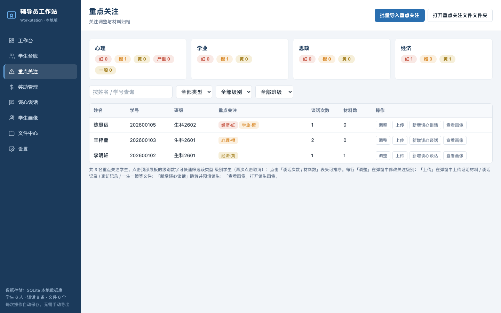
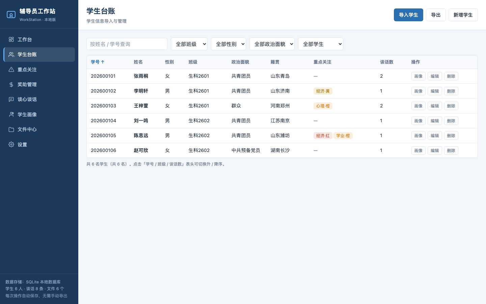
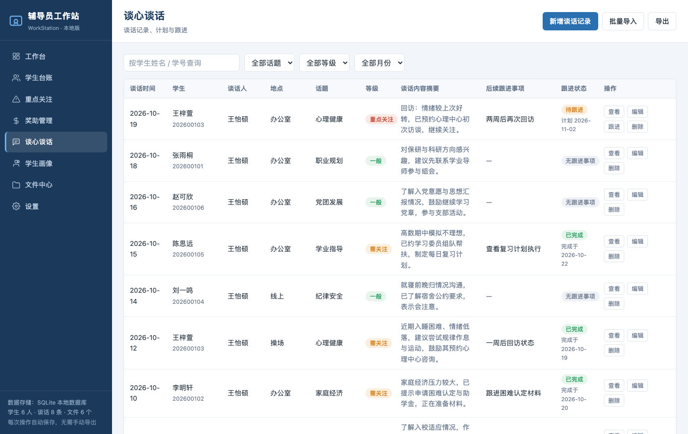
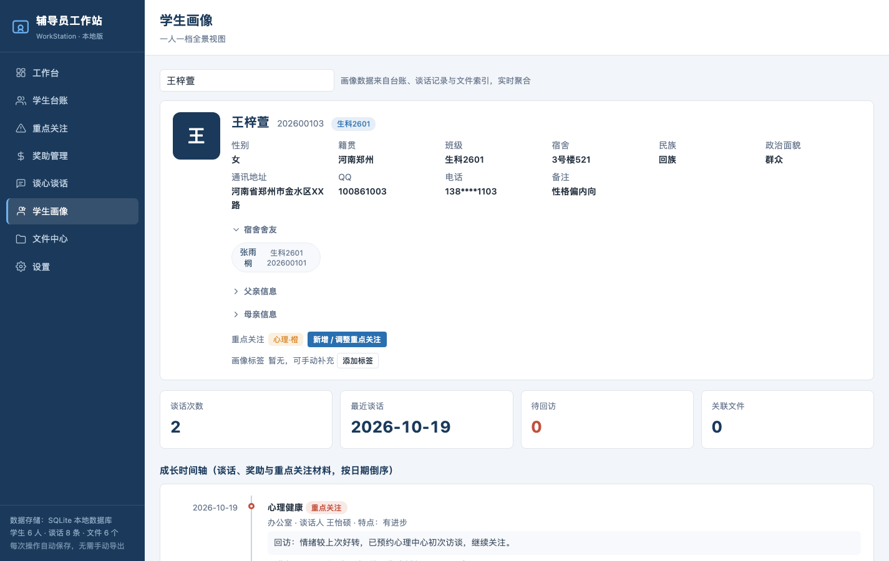

# 辅导员工作站 · 本地版（WorkStation · MVC + SQLite）

完全运行在本机、不联网、不共享的单机版辅导员工作平台。所有业务数据保存在本地 **SQLite 数据库**（`db/workstation.db`）中，通过浏览器使用；重点关注材料、谈话附件、文件中心导入文件分别保存在本地「重点关注文件」「谈话文件」「文件中心文件」文件夹。

## 版本更新说明

### v3.0（2026-10-29）

**重点关注板块：谈话次数、材料数与排序、展板快速筛选**
- 列表新增「谈话次数」列（自动统计该生已登记的谈心谈话条数）与「材料数」列（绑定到该生画像的关联材料数量，与学生画像「关联材料」保持一致）。
- 「谈话次数」「材料数」表头支持点击排序，再点一次切换升 / 降序。
- 顶部四类关注展板（心理 / 学业 / 思政 / 经济）上的每个级别数字均可点击，直接快速筛选出该「类型 · 级别」的学生；再次点击同一级别取消筛选。



**学生台账：表头排序**
- 「学号」「班级」「谈话数」三列表头支持点击排序，再点一次切换升 / 降序；默认按班级升序排列。



**谈心谈话：后续跟进事项 + 跟进状态三态 + 跟进操作**
- 原「跟进」列拆分为「后续跟进事项」与「跟进状态」两列。跟进状态分三态：
  - **无跟进事项**：新增谈话时未填写后续跟进事项；
  - **待跟进**：填写了跟进事项但尚未完成，显示计划跟进日期；
  - **已完成**：点击「跟进」登记完成时间后转为已完成，显示完成日期。
- 操作栏新增「跟进」按钮（仅待跟进记录显示）：点击后在弹窗中选择完成日期（默认今天），确认后状态自动转为已完成；查看详情弹窗同步展示跟进状态、跟进事项与计划 / 完成日期。
- 批量导入谈话时「后续跟进事项 / 跟进日期 / 跟进状态」均可缺失，按上述规则自动归一；导出时状态列输出三态文本。



**台账 / 重点关注批量导入：重复学号先预览，再选择覆盖或跳过**
- 导入学生台账时，已存在的学号会在预览表中标注「将覆盖（原：姓名）」，可选择「跳过重复（仅导入新记录）」或「覆盖重复并导入」；覆盖时保留该生原有重点关注、创建时间等信息，仅更新本次导入的字段。
- 批量导入重点关注时，该生已存在的同类型关注同样先在预览中标注「覆盖：心理·黄 → 心理·橙」，可选择跳过已有同类或覆盖同类；其他类型关注保持不变。

**学生画像：宿舍舍友区**
- 学生基本信息中，在「父亲信息」之前新增「宿舍舍友」区，自动列出同宿舍（宿舍号相同）的其他学生姓名、班级与学号；点击舍友姓名即可跳转到对应舍友的学生画像。未填写宿舍或暂无舍友时给出空态提示。



### v2.3（2026-10-23）
- **版本升级不再丢数据（重要）**：核查确认程序本身不会在启动时清空或重建数据库（仅建表与补列迁移）。此前更新后需重新导入，是旧版本交付流程中清空了正式库所致。自本版本起：**升级后自动保留并加载既有数据库数据，无需重新导入**；如需确认数据仍在，可在「设置 → 数据存储 → 连接数据库」查看当前库路径与数据量。
- **设置-数据存储**：新增「连接数据库」按钮，一键连接本机 workstation.db 并显示数据库路径、文件大小与学生 / 谈话 / 文件数量；「打开数据库所在文件夹」现会真实在访达中打开数据库所在目录。
- **设置-数据保险与清理**：导出备份可选 **db 格式**（直接下载数据库文件副本，适合升级前整体备份）或 **JSON 格式**（换机迁移用）；保留导入备份、载入示例数据、清空全部数据。
- **重点关注**：列表中每行的「调整 / 上传」拆分为独立的「调整」与「上传」按钮——「调整」跳转到该生关注级别调整区，「上传」跳转到该生关注材料上传区，并分别自动滚动定位。
- **谈心谈话**：操作栏新增「查看」按钮，弹窗查看该条谈话的完整详情（时间 / 学生 / 谈话人 / 地点 / 话题 / 等级 / 学生特点 / 谈话内容 / 后续跟进 / 回访状态），支持一键转编辑。
- **学生画像**：移除「台账已标记心理特殊关注，请注意保护谈话记录隐私」等全部警示提醒卡片，画像页只保留信息、关注标签与时间轴，界面更简洁。

### v2.2（2026-10-23）
- **学生画像 → 新增重点关注**：画像页「重点关注」区新增「新增 / 调整重点关注」按钮，点击直接跳转至重点关注板块并自动打开该生的关注调整，可立即标记或修改级别。
- **心理类关注改为五级**：心理类级别调整为 **红 / 橙 / 黄 / 严重 / 一般** 五级；学业 / 思政 / 经济仍为 红 / 橙 / 黄 三级。统计、详情表单、级别筛选、台账筛选、标签样式已同步。
- **重点关注批量导入**：重点关注板块新增「批量导入重点关注」。
  - 支持 CSV 文件或从 Excel 粘贴，表头固定三列：**学号、类型、级别**，三项均必填；
  - 学号与学生台账自动绑定，未匹配到台账学号的行跳过并列出明细；
  - 类型限 心理 / 学业 / 思政 / 经济；级别按类型校验（心理五级，其余三级）；
  - 同一学生同一类型已有关注会被覆盖，其他类型保留；
  - 支持下载导入模板，导入结果（成功条数 + 失败明细）实时反馈。

### v2.1（2026-10-23）
- **启动即自动加载数据**：每次运行「启动工作站.command」启动服务时，自动完成数据库建表与字段迁移（升级旧库无需手动处理），并打印数据加载概况（学生 / 谈话 / 文件索引 / 奖助项目 / 困难认定 / 申报记录数量），确认数据已加载至工作站。
- **重点关注-心理类改为两级**：心理类关注级别调整为 **严重 / 一般** 两级；学业 / 思政 / 经济仍为 红 / 橙 / 黄 三级。
  - 重点关注板块统计、学生台账筛选、导入模板（`心理:严重` / `心理:一般`）、画像与列表标签、详情回显均已同步。
  - 旧数据兼容：存量 `心理:红/橙/黄` 数据保留原值显示，编辑表单回显时归一为 严重/一般（红→严重、橙/黄→一般），保存后即为新级别。
- **工作台看板修复与精简**：
  - 修复「政治面貌分布」图表显示错误（饼图数据格式问题，含未填写政治面貌的归类展示）；
  - 删除「谈话关注等级」图表与「谈话覆盖率」统计卡（保留：学生总数、男生/女生、本月谈话、待回访、重点关注、政治面貌分布、谈话话题 Top 6）。

### v2.0（2026-10-23）
- **新增「奖助管理」板块**：奖助项目（类型：困难认定/助学金/奖学金/勤工助学/其他）→ 困难认定（每生每学年一条，等级：特别困难/困难/一般困难）→ 申报记录（按项目按学生勾选批量添加、筛选、导出）三表闭环。
  - 困难认定支持 **CSV 批量导入**（学号匹配台账、未匹配/等级无效/同学年重复跳过并列出明细），登记结果自动并入学生画像成长时间轴，并给出经济关注级别调整建议。
  - 申报记录关联上传材料（认定表/佐证材料/申请表/证明材料等），文件存入「奖助文件」文件夹并自动改名为 `YYYYMMDD-姓名-文件类型`，同步登记到该生画像时间轴与关联材料。
- **台账导出配置化**：导出前可选列（26 列，含专业、家庭情况、重点关注、谈话数）与导出范围（全部 / 当前筛选结果），CSV 带 UTF-8 BOM，文件名含日期与范围。
- **谈话批量导入**：按模板 CSV（谈话时间/地点/姓名/学号/性别/年级/学历/话题/谈话要点记录/备注）批量导入，必填校验 + 学号匹配，跳过明细可查；导入后列表即时更新、画像谈话数同步。
- **谈话导出配置化**：同台账导出体验（13 列勾选 + 全部/筛选范围）。
- **学生画像家长信息默认折叠**：父亲/母亲信息改为可折叠面板（默认收起），防止投屏时泄露家庭联系方式；展开/收起不造成布局跳动。
- 学生台账、重点关注的既有能力不变（学号唯一、跳过明细、自动改名落盘等）。

### v1.0（2026-08）
- 完成 MVC 架构（Python HTTPServer + SQLite + 浏览器端视图），七个核心视图闭环；重点板块支持文件上传自动改名落盘与画像时间轴联动。

## 快速开始

1. **双击「启动工作站.command」**（首次双击若提示“无法打开，因为无法验证开发者”，请右键 → 打开 → 打开）。
2. 终端会显示服务已启动，并**自动打开浏览器**进入工作台。
3. 停止使用：关闭弹出的终端窗口，或在该窗口按 `Ctrl+C`。数据始终保留在数据库中。

> 依赖：仅需 macOS 系统自带的 Python 3（`/usr/bin/python3`，标准库自带 sqlite3），**无需安装任何软件**。若系统缺少 python3，脚本会提示。

## 项目结构（MVC 分层）

```
WorkStationMVC/
├── 启动工作站.command   # 双击启动（自动开浏览器）
├── server.py            # 入口：HTTP 服务（仅监听 127.0.0.1）
├── README.md
├── models/
│   └── db.py            # Model 层：SQLite 建表与数据访问（DAO）
├── controllers/
│   └── api.py           # Controller 层：REST API 路由处理
├── views/               # View 层：浏览器端页面
│   ├── index.html       #   页面骨架（八视图）
│   ├── css/style.css    #   样式
│   └── js/
│       ├── model.js     #   Model：/api 数据访问与本地缓存
│       ├── view.js      #   View：八视图渲染、表单、图表
│       ├── controller.js #  Controller：路由与业务操作
│       └── app.js       #   入口
├── 重点关注文件/        # 重点关注板块上传的材料（自动命名：YYYYMMDD-姓名-文件类型）
├── 谈话文件/            # 谈心谈话附件（自动命名：YYYYMMDD-姓名-谈话记录/照片-编号）
├── 文件中心文件/        # 文件中心「导入文件」复制进来的本地文件本体
├── 奖助文件/            # 历史奖助材料目录（保留用于打开本地文件夹）
└── db/
    ├── workstation.db   # SQLite 正式数据库（首次启动自动创建）
    └── test.db         # 空测试库（设置中可一键链接，试操作不污染正式数据）
```

## 数据存储

- **全部业务数据入数据库**：学生台账、谈心谈话、重点关注、困难认定、奖学金、助学金、文件索引、画像标签、设置、元信息均存于 `db/workstation.db`（SQLite）；`db/test.db` 为可切换的空测试库。
- 每次新增 / 修改 / 删除 / 上传后**自动写入数据库**，无需手动保存或导出。
- 学号在台账中**唯一**：手动保存与批量导入都会校验；批量导入遇到重复学号先预览，由用户选择跳过或覆盖。
- 同一名学生同一名称、同一获评学年的奖学金 / 助学金记录**唯一**：重复条目被唯一索引拦截。
- 上传文件实体写入本地文件夹（`重点关注文件/`、`谈话文件/`、`文件中心文件/`），重点关注材料自动改名为 `YYYYMMDD-姓名-文件类型.扩展名`，谈话附件自动改名为 `YYYYMMDD-姓名-类型-编号`（同名自动加序号），仅存本机。

## 八个功能视图

| 视图 | 说明 |
|---|---|
| 工作台 | 学生统计、本月谈话、待回访、重点关注、政治面貌分布、谈话话题 Top 6 与最近记录待办 |
| 学生台账 | 学生基本信息 + 家庭情况 + 备注；支持筛选、**学号 / 班级 / 谈话数表头排序**、CSV 批量导入（重复学号先预览，可选覆盖或跳过）、配置化导出（选列 + 范围） |
| 重点关注 | 四类关注统计与调整：心理（红 / 橙 / 黄 / 严重 / 一般五级）、学业 / 思政 / 经济（红 / 橙 / 黄三级）；同一学生可并存多类关注、同一类型仅保留一个级别；**谈话次数 / 材料数列与表头排序**；展板级别数字点击快速筛选；批量导入（学号 / 类型 / 级别必填，学号绑定台账，重复同类先预览可选覆盖或跳过）；弹窗内调整级别、上传证明材料 / 谈话记录 / 家访记录 / 一生一策等文件（自动改名存本地）；可打开本地文件夹 |
| 奖助管理 | 困难认定、奖学金、助学金三页签；奖学金 / 助学金仅用于数据汇总展示、不做审批；支持批量导入（学号、名称、等次、获评学年、获评时间）与关联台账列的批量导出；困难认定 CSV 批量导入并给出经济关注级别调整建议 |
| 谈心谈话 | 谈话时间 / 学生 / 谈话人 / 地点 / 话题 / 等级 / 内容 / **后续跟进事项 / 跟进状态（无跟进事项 · 待跟进 · 已完成）**；支持筛选、查看详情、**跟进登记完成时间**、CSV 批量导入与配置化导出；谈话附件自动绑定画像 |
| 学生画像 | 一人一档：基本信息、**宿舍舍友（点击跳转舍友画像）**、家长信息折叠面板（默认收起，防投屏泄露）、重点关注、画像标签、成长时间轴（谈话 + 奖助 + 重点关注材料，跟进事项与状态同步展示）、关联材料 |
| 文件中心 | 按文件名登记索引（不检索内容）；支持拖拽注册、文件夹索引、筛选、导出；文件可在默认浏览器预览、可打开所在文件夹 |
| 设置 | 访问密码、默认谈话人、话题 / 文件分类 / 重点关注文件类型字典、数据库连接（正式库 / 空测试库切换）、DATABASE 备份 / JSON 备份、导入 DATABASE / JSON 备份、载入示例数据、清空全部数据 |

## 奖助管理板块使用说明

奖助管理仅用于数据的汇总展示，不承担审批流程，下设「困难认定」「奖学金」「助学金」三个页签。

1. **困难认定**：可逐条新增（输入姓名 / 学号选择学生，每生每学年一条，重复自动更新），或「批量导入名单」下载模板按 学号、等级、评议结果、学年 导入；等级限 特别困难 / 困难 / 一般困难。认定结果自动并入该生画像成长时间轴，并提示是否需同步调整经济关注级别。
2. **奖学金 / 助学金**：两个页签结构一致，只做汇总登记与展示。
   - **批量导入**：下载模板后按 学号、奖助名称、等次、获评学年、获评时间 五列填写；学号须与台账一致，等次限 一等 / 二等 / 三等 / 不记等次；未匹配学号、等次无效、学年或时间缺失、同生同名同学年重复的行跳过并列出明细。
   - **批量导出**：导出时自动关联学生台账，可勾选需要一并导出的台账数据列与奖助数据列，范围可选全部或当前筛选结果。
3. 获评记录自动并入该生画像成长时间轴。

## 重点关注板块使用说明

1. **标记关注**：进入「重点关注」板块，选择学生 → 在 心理（红 / 橙 / 黄 / 严重 / 一般）、学业 / 思政 / 经济（红 / 橙 / 黄）四类上选择级别或「无」→ 保存。一名学生可同时存在多类关注（如经济·黄 + 心理·一般），但同一类型只保留一个级别。标记同步显示在学生台账列与学生画像中；也可用「批量导入重点关注」按 学号、类型、级别 三列批量导入（学号须与台账一致，重复同类先预览，可选覆盖或跳过）。
2. **列表统计与排序、快速筛选**：列表「谈话次数」自动统计该生谈话条数，「材料数」绑定画像关联材料数量；点击这两列表头可排序。顶部展板上每个类型的级别数字可点击，快速筛选该「类型 · 级别」学生，再次点击取消。
3. **上传材料**：选择学生 → 在弹窗中选择文件类型（证明材料 / 谈话记录 / 家访记录 / 一生一策 / 其他，类型字典可在「设置」中维护）与日期 → 选择文件上传。
   - 文件自动改名为 `YYYYMMDD-姓名-文件类型.扩展名`（如 `20261022-张雨桐-谈话记录.docx`），同名时自动加序号（`-2`）。
   - 文件实体保存在项目 `重点关注文件/` 文件夹，仅存本机；「打开重点关注文件文件夹」按钮可在访达中打开。
   - 上传后自动登记到该学生的画像成长时间轴与关联材料中。
4. **删除材料**：删除索引仅移除数据库中的索引记录，实体文件保留在本地文件夹（避免误删）。

## 导出与批量导入

- **配置化导出**：学生台账与谈心谈话的「导出」按钮弹出配置窗口——勾选要导出的列（可全选 / 清空）、选择范围（全部记录 / 当前筛选结果），导出的 CSV 为 UTF-8 带 BOM（Excel 打开不乱码），文件名自动包含日期与范围（如 `学生台账_2026-10-29_筛选结果.csv`）。
- **学生台账批量导入**：「学生台账 → 导入学生」选择 CSV 或从 Excel 粘贴；学号唯一，导入前先预览，已存在的学号标注「将覆盖（原：姓名）」，可选择「跳过重复（仅导入新记录）」或「覆盖重复并导入」；覆盖时保留该生原有重点关注与创建时间，仅更新本次导入字段。
- **谈心谈话批量导入**：「谈心谈话 → 批量导入 → 下载导入模板」，模板列为 谈话时间、地点、姓名、学号、话题、谈话要点记录、后续跟进事项、跟进日期、跟进状态；必填 谈话时间 / 学号 / 谈话要点记录，按学号匹配台账学生；后续跟进事项、跟进日期、跟进状态均可缺失——未填事项记为「无跟进事项」，填写事项默认「待跟进」，状态填「已完成」记为已完成；未匹配学号或缺失必填项的行跳过并在预览中列出明细。
- **重点关注批量导入**：表头固定 学号、类型、级别，三项必填；同类型已存在的级别先在预览中标注覆盖关系，可选择跳过已有同类或覆盖同类，其他类型保留。

## 从旧版（单文件 HTML）迁移数据

旧版数据在两个位置：浏览器本地存储（localStorage）或“数据文件夹”中的 JSON / CSV 文件。迁移方式：

- **学生台账**：旧版设置页或文件中心可导出 `学生台账_日期.csv` → 新版本「学生台账 → 导入学生 → 选择 CSV 文件」导入；遇到重复学号先预览，可选择跳过或覆盖。
- **其余数据（谈话 / 文件索引 / 画像 / 设置）**：旧版「设置 → 导出备份」得到 `辅导员工作站备份_日期.json` → 新版本「设置 → 导入备份」整体导入。
- 也可以直接拷贝整个 `db/workstation.db` 文件到新电脑（换机迁移）。

## 常见问题

- **服务启动后浏览器没自动打开？** 手动在浏览器地址栏输入 `http://127.0.0.1:8790/`。
- **端口被占用？** 启动脚本会自动改用 8791–8799 中的可用端口，并打印实际地址；跨站写请求防护按实际端口自动匹配本机页面。
- **锁屏密码忘了？** 密码哈希存在数据库中，无法找回；可在「设置 → 清空全部数据」后重新使用（会丢失数据，请务必先导出备份）。
- **安全说明**：本服务仅监听本机回环地址 `127.0.0.1`，不对外网开放，数据不会上传；学生信息属敏感个人信息，建议对项目所在磁盘启用「文件保险箱」加密。画像中家长信息默认折叠，避免投屏时泄露联系方式。

## 后端 API 一览（供参考）

- `GET  /api/state` — 全量数据（学生 / 谈话 / 文件 / 画像 / 困难认定 / 奖学金 / 助学金 / 设置）
- `GET  /api/dbinfo` — 当前数据库连接信息（路径 / 大小 / 数据量 / 库类型：正式库 / 空测试库）
- `POST /api/db/switch` — 切换正式库 / 空测试库（body：`target = main | empty`）
- `POST /api/db/openfolder` — 在访达中打开数据库所在文件夹
- `GET  /api/backup/db` — 导出 DATABASE 备份（下载 `.db` 数据库文件副本）
- `POST /api/backup/import` — 导入 JSON 格式备份（整体覆盖学生、谈话、文件、奖助等数据）
- `POST /api/backup/import-db` — 导入 DATABASE 格式备份（multipart 上传 `.db`，校验 SQLite 头与必备表后替换当前库）
- `POST /api/students` / `PUT|DELETE /api/students/{id}` — 学生增改删（学号唯一）
- `POST /api/talks` / `PUT|DELETE /api/talks/{id}` — 谈话增改删
- `POST /api/talks/{id}/done` — 跟进完成登记（body：`date` 完成日期，缺省取当天；状态转为已完成）
- `POST /api/talks/upload` — 谈话附件上传（multipart：sid、type=谈话记录/照片、date、file，自动改名 `YYYYMMDD-姓名-类型-编号` 并绑定画像）
- `POST /api/files` / `PUT|DELETE /api/files/{id}` — 文件索引增改删
- `POST /api/files/import` — 文件中心批量注册本地文件（multipart）
- `GET  /api/files/{id}/open` — 预览文件（默认浏览器打开文件本体）
- `POST /api/files/openfolder` — 打开文件所在本地文件夹
- `POST /api/focus/upload` — 重点关注材料上传（multipart：sid、type、date、file，自动改名并落盘）
- `POST /api/focus/openfolder` — 在访达中打开「重点关注文件」文件夹
- `POST /api/aid/hardship` / `PUT|DELETE /api/aid/hardship/{id}` — 困难认定增改删（每生每学年自动 upsert）
- `DELETE /api/scholarships/{id}` / `DELETE /api/grants/{id}` — 删除单条奖学金 / 助学金记录
- `POST /api/portraits/tags` — 添加画像标签
- `PUT  /api/settings` — 保存设置（话题 / 分类 / 文件类型字典等，含 meta）
- `POST /api/import/students` — 批量导入学生（body：`records`、`overwrite`；`overwrite=true` 覆盖重复学号并保留原有关注与创建时间，`false` 跳过重复；返回 `{imported, skips}`）
- `POST /api/import/concerns` — 批量导入重点关注（body：`records`、`overwrite`；同类型重复可跳过或覆盖；返回 `{imported, skips}`）
- `POST /api/import/talks` — 批量导入谈话（识别后续跟进事项 / 跟进日期 / 跟进状态，缺失容错；返回 `{imported, skips}`）
- `POST /api/import/hardship` — 批量导入困难认定（学号匹配 + 等级校验 + 同学年去重，返回 `{imported, skips}`）
- `POST /api/import/scholarships` / `POST /api/import/grants` — 批量导入奖学金 / 助学金（学号匹配 + 等次 / 学年 / 时间校验，返回 `{imported, skips}`）
- `POST /api/seed` / `POST /api/reset` — 载入示例数据 / 清空数据

> 示例数据（6 名学生、8 条谈话、6 个文件索引）全部为虚构，仅用于体验功能。

## 高级（可选）

- 可用环境变量 `WS_DB=/路径/xxx.db` 指定数据库文件位置（默认 `db/workstation.db`），便于测试或分离数据。
- 静态页面与脚本启用了「每次重新校验缓存」，升级或修改代码后刷新浏览器即可生效。
